# OpenGL Renderer

A real time renderer written in C++ using OpenGL 4.6.

---

## Features

### Rendering

- OpenGL rendering pipeline
- Forward and deferred shading
- Blinn-Phong and physically based rendering (PBR) using the Cook-Torrance BRDF
- Directional, point, and spot lights
- Instanced rendering
- Skyboxes
- Cubemap reflections and refractions
- Normal mapping
- Shadow mapping with simple percentage closer filtering (PCF)
- Screen Space Ambient Occlusion (SSAO)


### Materials

- Diffuse, specular, and normal textures
- Support for both Blinn-Phong and PBR materials
- Material abstraction for managing shaders and textures
- Support for imported model materials
- Support for embedded textures and packed metallic-roughness maps


### Model Loading

- Assimp integration
- Use of Assimp to import models which are converted into my model format that can be rendered with the pipleline
- Support for importing material properties and textures
- Tangent and bitangent generation for normal mapping


### Post Processing

- Framebuffer rendering
- Convolution filters for viusual effects
- Gamma Correction
- HDR/tone mapping
- SSAO with noise sampling and blur


### User Interface

- Dear ImGui integration
- Runtime scene selection
- Rendering options and debugging controls

---

## Libraries

- OpenGL 4.6
- GLFW
- GLAD
- GLM
- Assimp
- stb_image
- Dear ImGui

---

## Project Structure

```
Renderer
│
├── Scene
├── SceneObject
├── Model
├── Mesh
├── Material
├── Texture
├── Shader
├── Camera
├── Framebuffer
└── Resources
```

Each scene is responsible for creating and updating objects, while the renderer handles all the drawing calls. Materials define how the surface of a model will look including any textures or material specific data that needs to be uploaded to the GPU. This allows models to be rendered without scene or material specific rendering logic.

---

## Examples
**Physically Based Rendering**
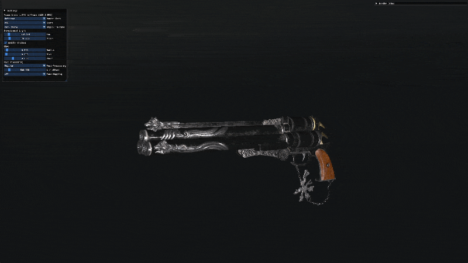
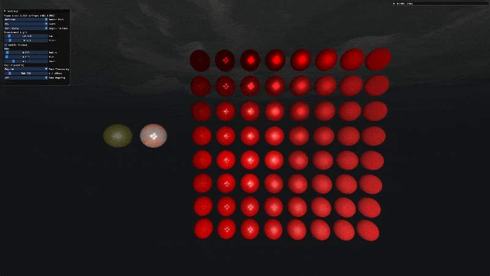

**Deferred Rendering**
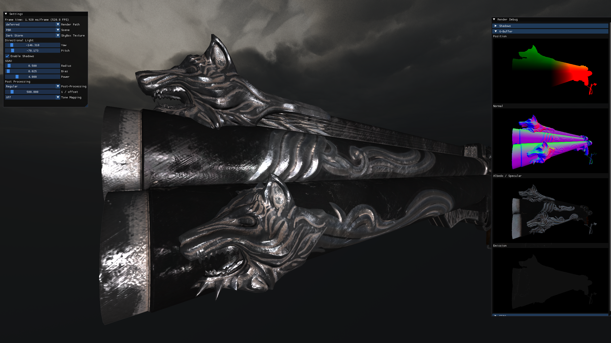
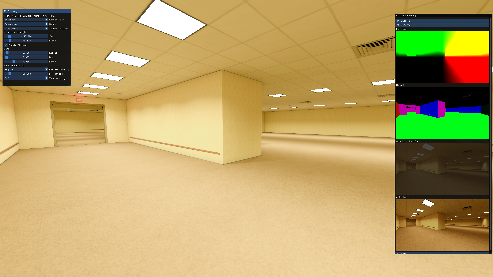

**SSAO**
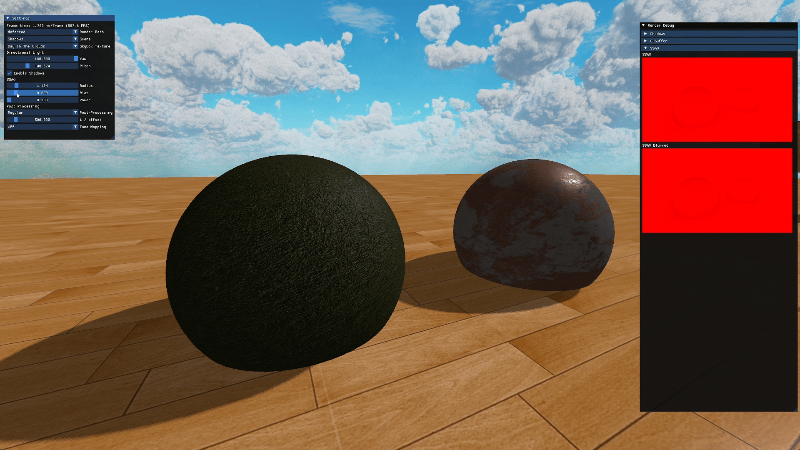

**Instanced Rendering**
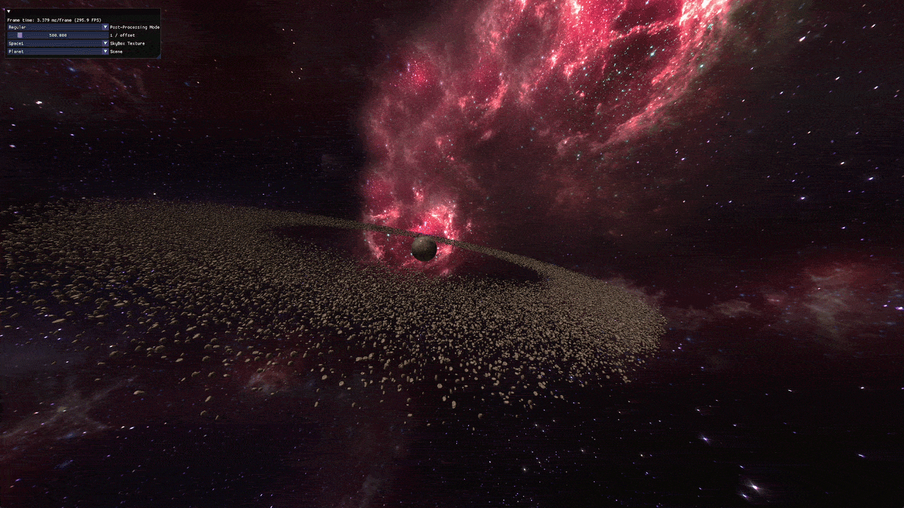

**Directional Shadow Mapping**
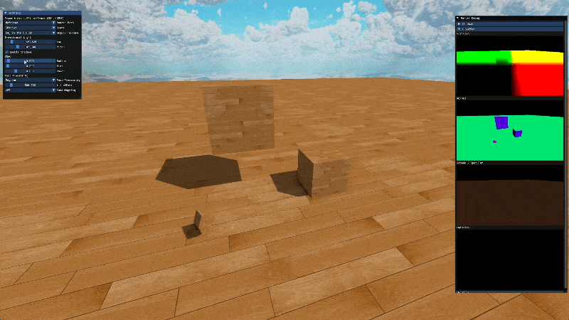

**Blinn-Phong Lighting**
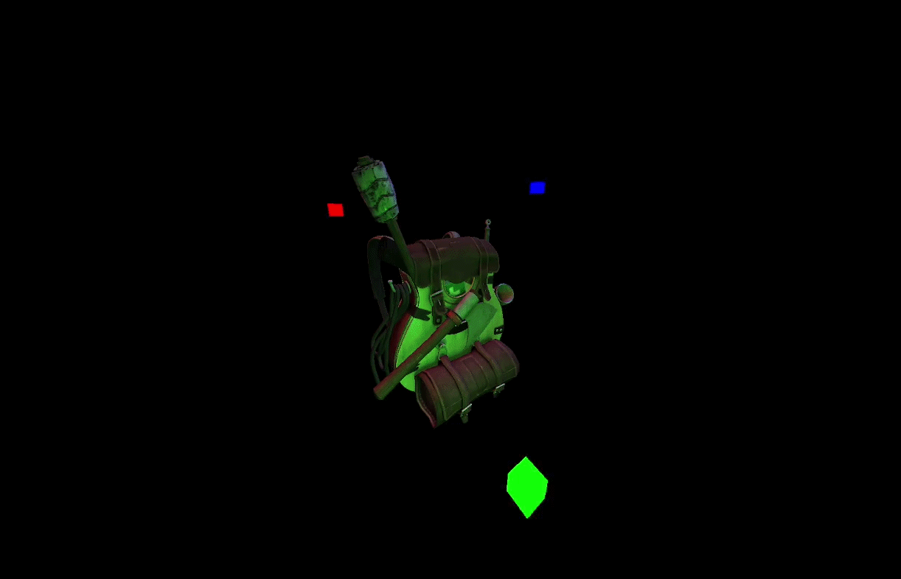

**Additional Effects**
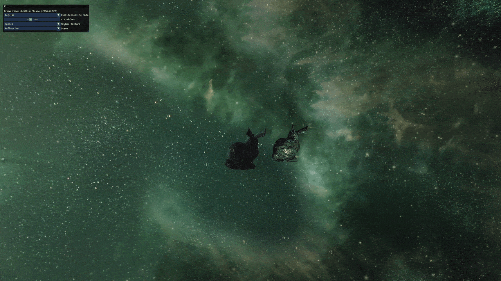
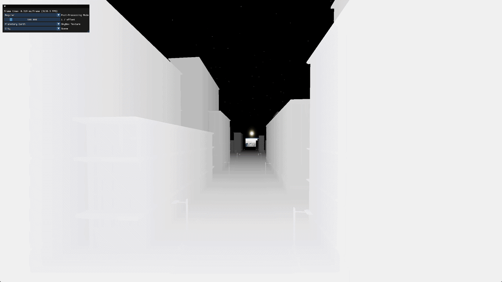
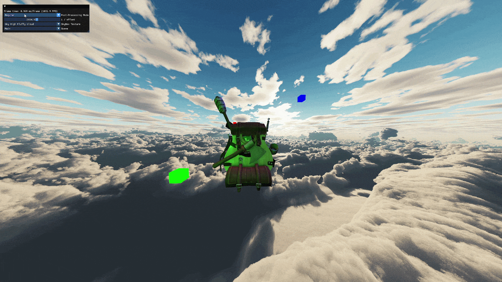


---

## Building

### Requirements

The project is currently developed and tested on:

- Windows 11
- Visual Studio 2026
- OpenGL 4.6

Some third party dependencies (such as the Assimp DLL) may need to be installed or copied into the executable directory before running. Some textures and models used are not included due to their size.

---

## Future Work

Some features planned for future versions include:

- Image Based Lighting (IBL)
- Omnidirectional shadow mapping
- Bloom
- Particle System
- Terrain Generation
- Parallax Mapping

---

## Motivation

This project is mainly a learning project focused on graphics programming. The goal is to gain a better understanding of real time rendering by implementing common graphics techniques directly rather than relying on an existing game engine.
